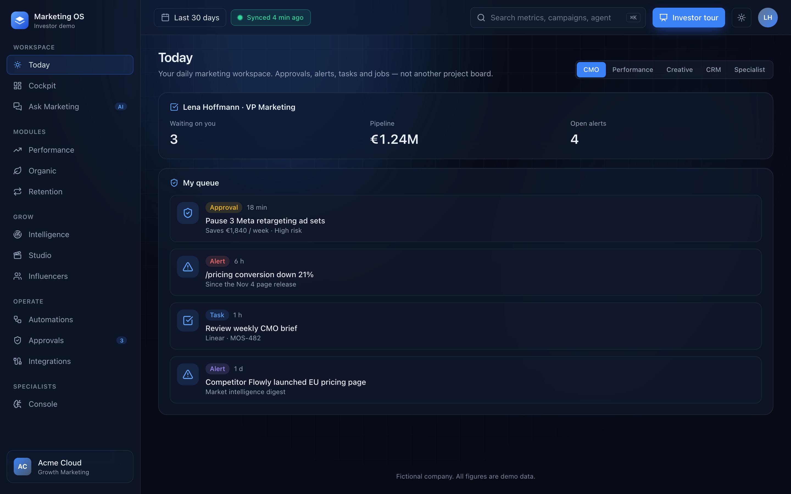

# Investor demo

An interactive mockup of Marketing OS that runs on fixed demo data. Use it in investor meetings and for design reviews. It lives on the `demo/investor` branch (removed from the default published tree). It never calls the API or Supabase and needs no login.

Product direction: [Planning/prd_v4_addendum.md](../../Planning/prd_v4_addendum.md). Decisions: [ADR-0022](../adr/0022-external-automation-platforms.md), [ADR-0023](../adr/0023-creative-tools-as-connectors.md).



| Document | What it covers |
| --- | --- |
| [design-system.md](design-system.md) | Colour, type, motion, components, accessibility |
| [screens.md](screens.md) | Every screen: purpose, PRD area, interactions, screenshot |
| [demo-script.md](demo-script.md) | The investor walkthrough with talking points |
| [concepts/](concepts) | Concept images approved before the first build |

## Run it

```bash
pnpm install
pnpm --filter @marketing-os/web dev
```

Open <http://localhost:3000/demo>. Press **Start the investor tour**, or **Explore freely** (opens Today).

Every screen has a light/dark toggle in the top bar. Dark is the default. The choice is saved in `localStorage` under `mos-demo-theme`.

## Routes

| Route | Screen |
| --- | --- |
| `/demo` | Landing page |
| `/demo/onboarding` | Onboarding wizard |
| `/demo/today` | Today (daily workspace) |
| `/demo/cockpit` | Cockpit |
| `/demo/ask` | Ask Marketing |
| `/demo/performance` | Performance module |
| `/demo/organic` | Organic module |
| `/demo/retention` | Retention module |
| `/demo/intelligence` | Market intelligence |
| `/demo/studio` | Creative studio |
| `/demo/influencers` | Influencer marketing |
| `/demo/automations` | Automations (+ external platforms) |
| `/demo/approvals` | Approvals |
| `/demo/integrations` | Integrations and data health |
| `/demo/console` | Specialist console |

All pages under `/demo` set `robots: noindex`.

## Demo data

The demo company is **Acme Cloud**, a fictional B2B SaaS company. All amounts are in EUR. The user is Lena Hoffmann, VP Marketing. Every page footer says "Fictional company. All figures are demo data."

Data is deterministic: time series use a seeded random generator (`mulberry32`) anchored to `DEMO_TODAY` (2026-11-10 UTC).

To change a number or a story, edit the files in `apps/web/src/demo/data/`. Nothing else reads these files.

## File map

```
apps/web/
  postcss.config.mjs
  src/app/demo/                 Routes and demo.css
  src/demo/
    data/                       company, cockpit, ask, modules, operate, console,
                                today, intelligence, studio, influencers
    lib/                        format, series, filter-creators, generation-job
    tour/                       17-step investor tour
    ask/                        Scripted Q&A
    components/                 Theme, toast, charts, viz, shell, ui/
e2e/demo/
  screenshots.mjs
  tour-smoke.mjs
```

## Tests and checks

```bash
cd apps/web
npx vitest run src/demo
npx tsc -p tsconfig.json --noEmit
npx eslint src/demo src/app/demo
```

```bash
DEMO_BASE_URL=http://localhost:3000 pnpm --filter @marketing-os/e2e demo:tour
DEMO_BASE_URL=http://localhost:3000 TOUR_SHOTS=1 pnpm --filter @marketing-os/e2e demo:tour
DEMO_BASE_URL=http://localhost:3000 pnpm --filter @marketing-os/e2e demo:screenshots
```

## Limits

- No real data, auth, or API calls. Buttons change local state only and reset on reload.
- Ask Marketing answers four scripted questions.
- Creative generation and connector syncs are simulated.
- External automation platforms are mocked panels (ADR-0022); nothing is embedded.
