# Screens

Eleven routes cover the eight requested areas. Section numbers refer to `Planning/agentic_marketing_os_prd_cursor_v2.md`. Screenshots are 1440 px wide; regenerate them with `pnpm --filter @marketing-os/e2e demo:screenshots` (see [README.md](README.md)).

The `data-tour` value is the element the guided tour highlights on that screen.

## Landing — `/demo`

**Purpose**: the investor's first view. It states the product, the thesis loop and how the open-core model makes money.

**PRD**: §1 Product Mission, §2 Product Thesis, §4 Commercial Access Model.

**Interactions**
- The product preview in the hero tilts toward the pointer.
- The thesis chain (Connect → Understand → Display → Ask → Design → Automate → Execute → Measure → Improve) lights up step by step when it scrolls into view.
- **Start the investor tour** opens onboarding with the tour running. **Explore freely** opens the cockpit.

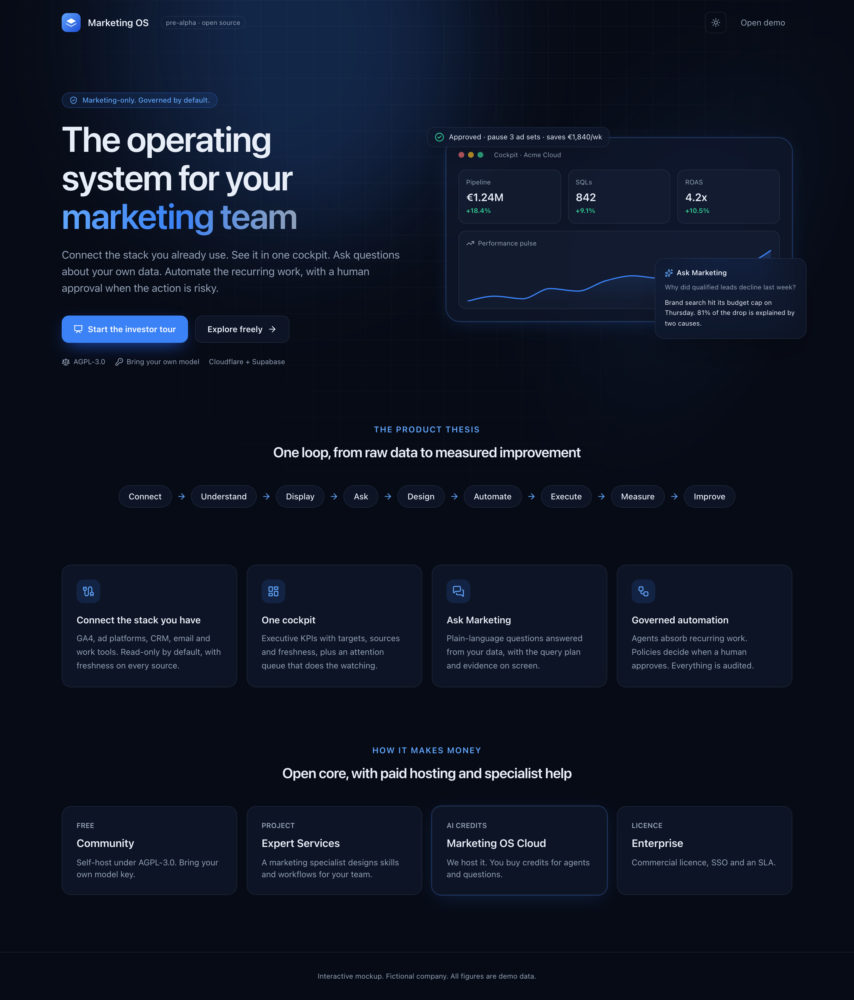

## Onboarding — `/demo/onboarding`

**Purpose**: shows that setup starts from the customer's existing stack.

**PRD**: §6 Steps 4–6 (integration onboarding, initial sync, cockpit generation), §12 Integration UX.

**Interactions**: four steps. Pick sources (tiles toggle), review the read-only scopes, set goals with sliders, then watch an animated build checklist that ends with a link to the cockpit.

`data-tour`: `onboarding-stack`.

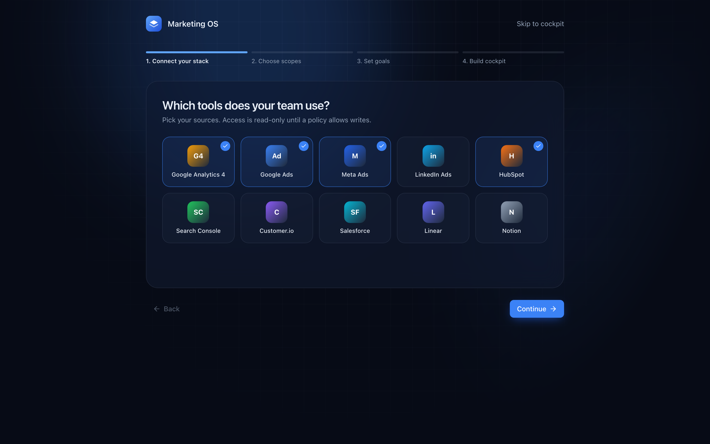

## Cockpit — `/demo/cockpit`

**Purpose**: the CMO's single view of marketing.

**PRD**: §8.1 Executive Overview, §23 CMO Cockpit Requirements.

**Interactions**
- KPI cards count up and show target progress, source and freshness.
- The performance pulse switches between 30, 14 and 7 days and compares with the previous period.
- The attention queue lists anomalies, risks and opportunities ranked by impact.
- **Approve** on a recommendation removes it with an animation and shows a toast.
- Pipeline by channel (donut) and the agent activity timeline.

`data-tour`: `cockpit-kpis`, `cockpit-pulse`, `cockpit-attention`, `cockpit-recommendations`.

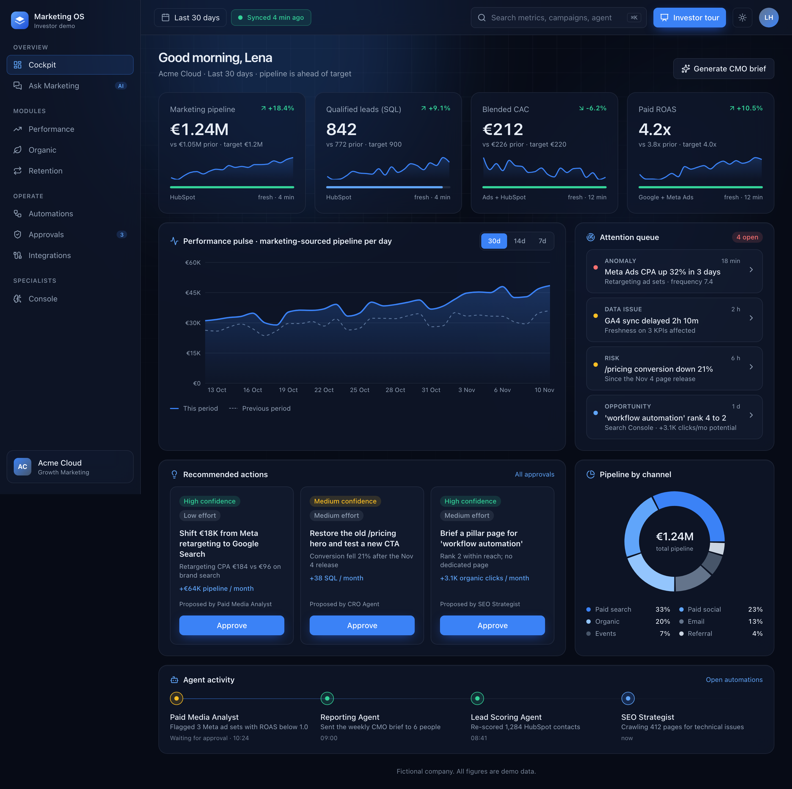
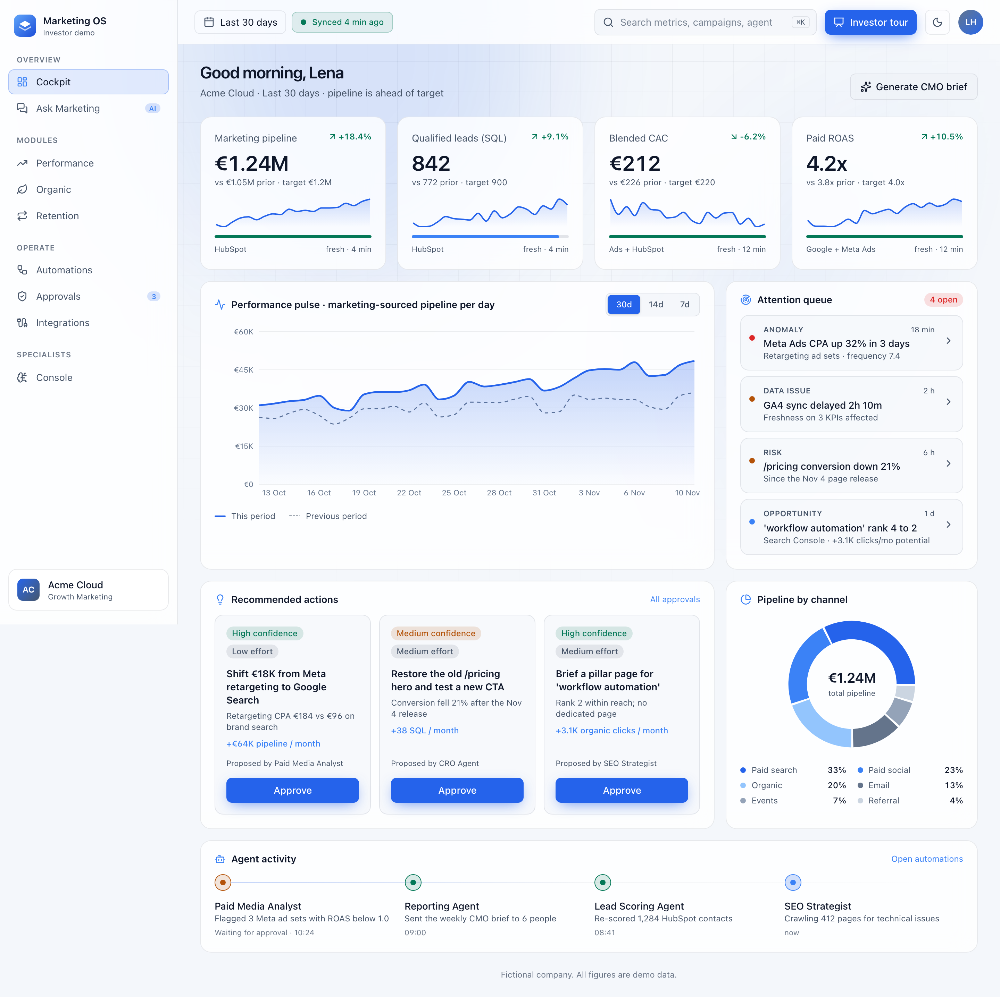

## Ask Marketing — `/demo/ask`

**Purpose**: plain-language questions answered from the customer's own data, with the working shown.

**PRD**: §14 Ask Marketing (requirements, query process, trust requirements).

**Interactions**
- The first question is already answered. Starter chips and the input ask the other scripted questions.
- A short "thinking" shimmer, then the answer streams in with a chart or table.
- The evidence panel steps through intent, metric definitions, sources, the SQL, and validation.
- Scripted questions: why qualified leads fell, which campaigns are inefficient, how channels compare on qualified leads, and what changed this week. Anything else gets a reply that lists those four.

`data-tour`: `ask-thread`, `ask-evidence`.

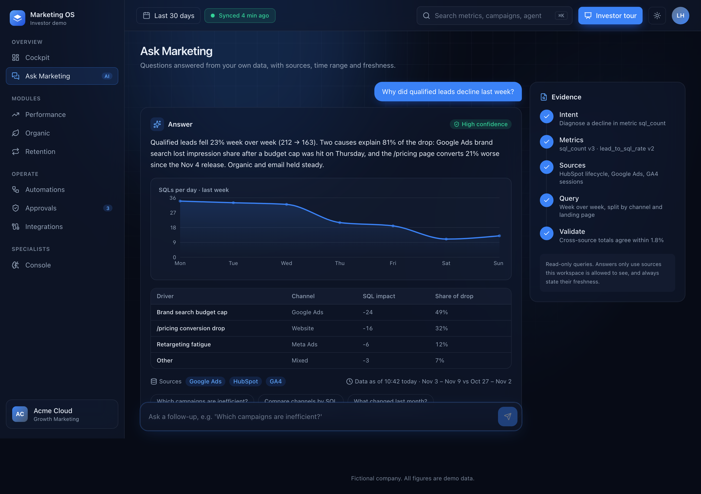
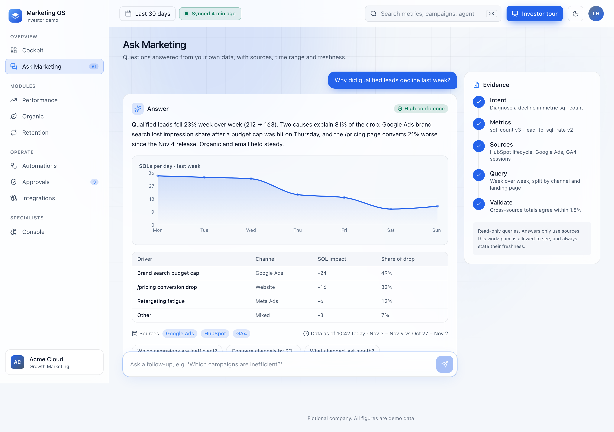

## Performance — `/demo/performance`

**Purpose**: paid media efficiency.

**PRD**: §8.2 Performance, §24 Performance Module.

**Interactions**: spend versus ROAS chart, a funnel from impressions to opportunities, and a campaign table you can sort by any column (rows animate into place).

`data-tour`: `performance-funnel`.

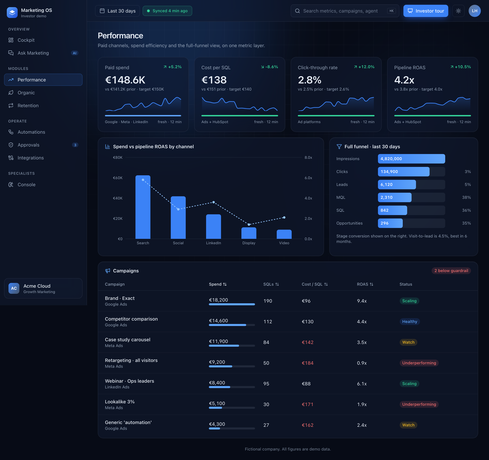

## Organic — `/demo/organic`

**Purpose**: SEO health and content opportunities.

**PRD**: §8.2 Organic, §25 Organic / SEO Module.

**Interactions**: 90-day organic traffic trend, a technical health score ring with issues, keyword positions with movement arrows, and **Generate brief** on each content opportunity.

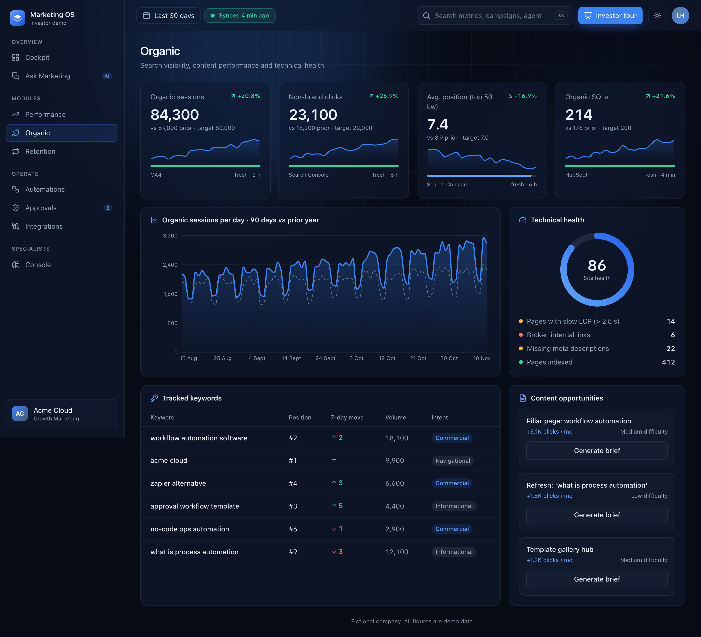

## Retention — `/demo/retention`

**Purpose**: customer retention and expansion.

**PRD**: §8.2 Retention, §27 CRM / Retention Module.

**Interactions**: logo retention by signup cohort (heatmap), churn-risk segments with inline bars, and lifecycle program results for the last 30 days.

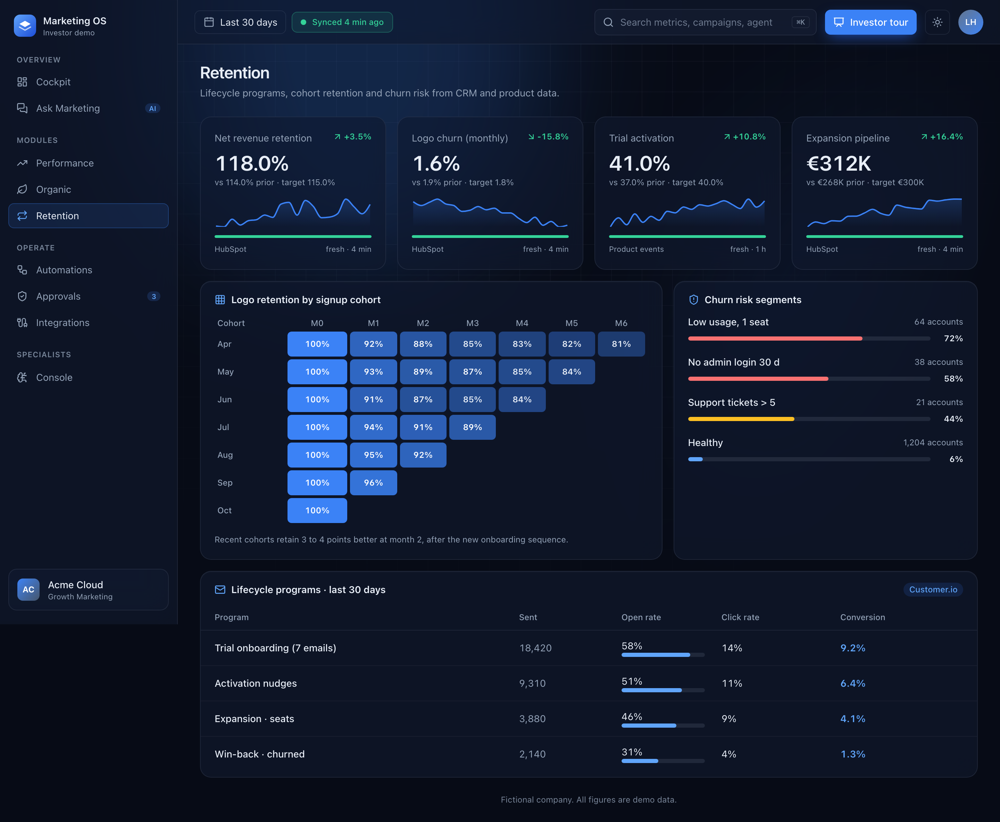

## Automations — `/demo/automations`

**Purpose**: recurring work run by agents under policy.

**PRD**: §19 Workflow System, §20 Automation Framework, §21.1 Weekly performance review.

**Interactions**
- **Run now** executes the weekly review workflow on the canvas. Nodes light up in order and the run stops at the approval node, waiting for a human.
- **Reset** returns the canvas to idle.
- Each automation has an on/off switch. Recent runs are listed with their outcome.
- The stats include AI credits used, which ties to the Cloud offer.

`data-tour`: `automations-canvas`.

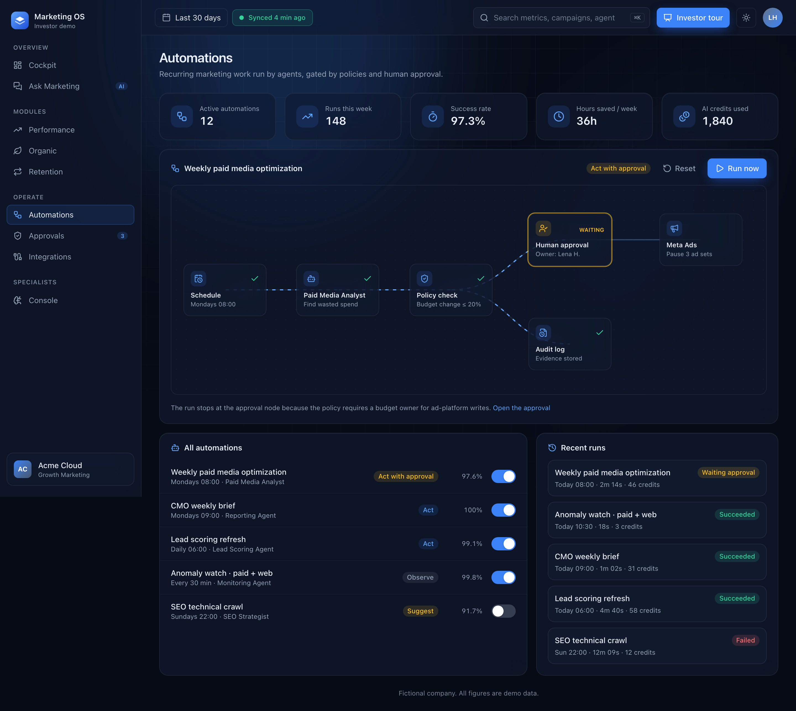

## Approvals — `/demo/approvals`

**Purpose**: risky actions wait for a person.

**PRD**: §31 Governance / Policy Engine, §32 Approval System, §33 Agent Autonomy.

**Interactions**: pick an item from the queue to see its evidence, the exact before/after change, and the policy that required approval. **Approve** or **Reject** records the decision, shows a toast and moves to the next pending item.

`data-tour`: `approvals-detail`.

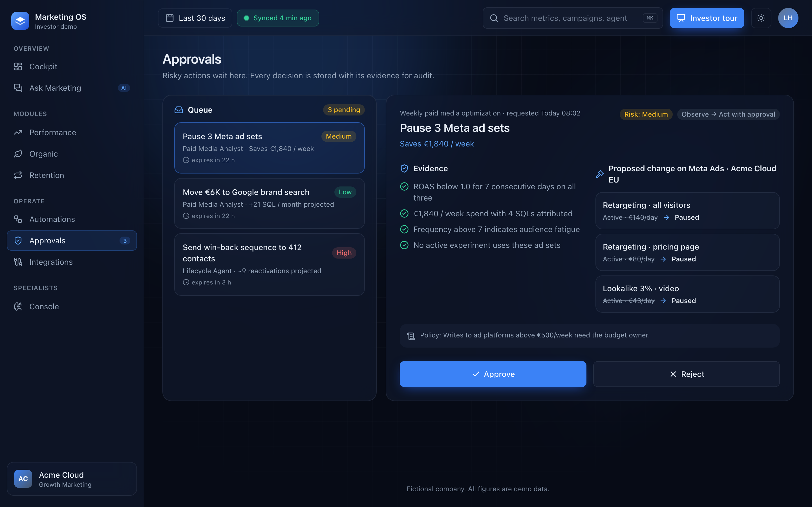

## Integrations and data health — `/demo/integrations`

**Purpose**: connectors and the health of the data behind every number.

**PRD**: §9 Data health, §11 Connector Framework, §12 Integration UX (including reconnection).

**Interactions**: **Connect**, **Reconnect** and **Sync now** run a short connecting → syncing → healthy sequence with a progress bar and a toast. The data-health table shows status, last sync, record counts and scope.

`data-tour`: `integrations-grid`.

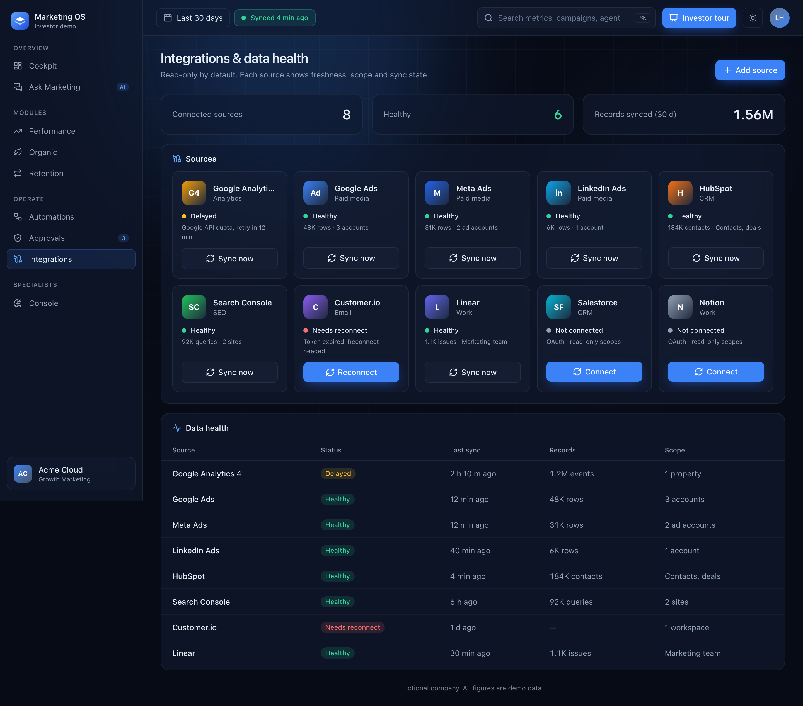

## Specialist console — `/demo/console`

**Purpose**: where specialists configure each customer; the basis of Expert Services.

**PRD**: §7.2 Internal Specialist Console, §16, §17 Skill System, §18 Agent System, §35 Prompt Management, §37 Internal Specialist Experience.

**Interactions**: four tabs.
- **Skills**: each skill with its evaluation score.
- **Agents**: change an agent's autonomy level (Observe, Suggest, Approve, Act); a toast confirms.
- **Prompts**: version timeline.
- **Customers**: the workspaces a specialist manages.

`data-tour`: `console-tabs`.

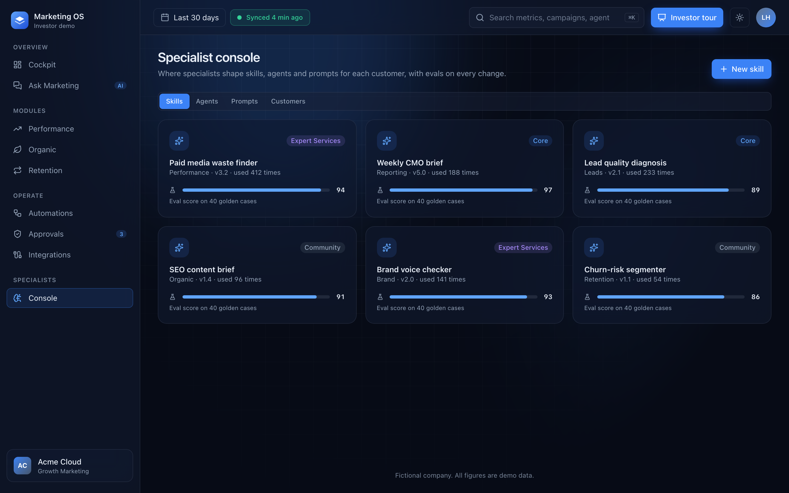
